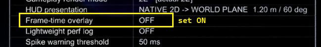
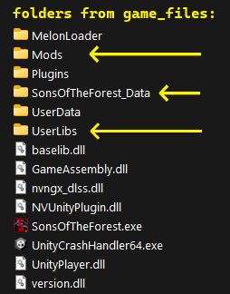
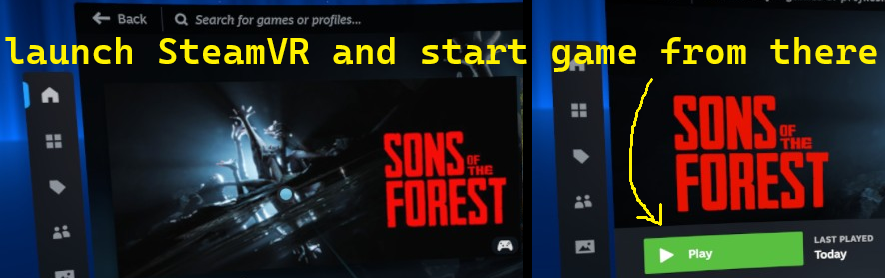
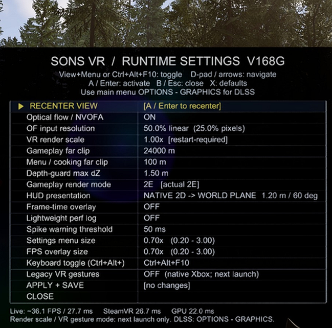
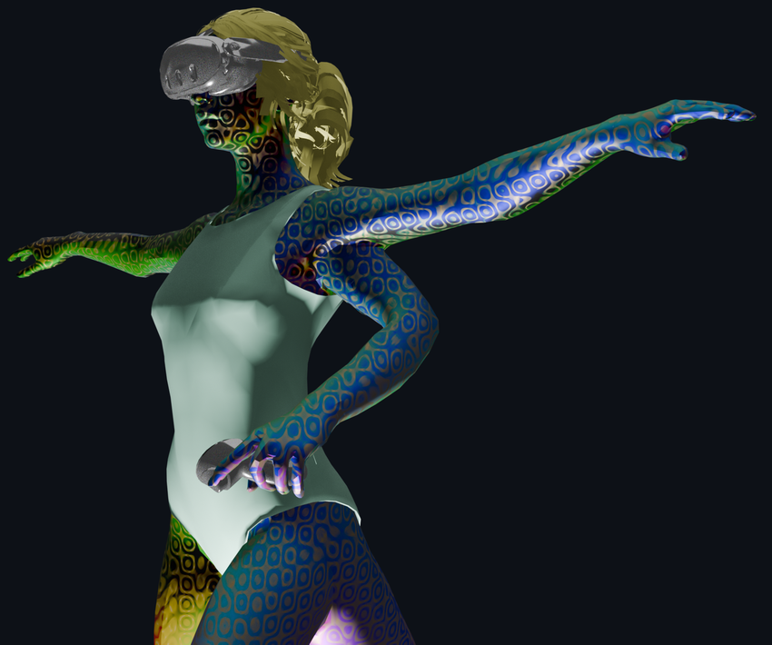

# Sons of the Forest VR Mod (Unofficial)
with AER, 2E (Stereo), DLSS, OF + many performance improvements

Original Mod by [iPowerTech/SonsVR_Mod](https://github.com/iPowerTech/SonsVR_Mod)\
Directly based on the Fork [Manny79/SonsVR_Mod](https://github.com/Manny79/SonsVR_Mod)


## Features in this Fork:

- New mode: AER (Alternate Eye Rendering)\
💡 BEST PERFORMANCE\
Get a view for two eyes, only render one eye and reconstruct\
Uses a compiled Unity shader for mipmaps depth correction
- Original Stereo Rendering for both eyes (2E) also available\
💡 BEST QUALITY\
Bearable performance impact due to DLSS (NVIDIA RTX only)
- NVIDIA DLSS (default on)\
Deep Learning Super Sampling for more FPS and higher quality\
Renders at a lower resolution, then AI upscales the result
- NVIDIA OF (Optical Flow) (default on)\
Makes it look like you have more FPS than you actually do

### 🆕 Reporting Bugs

1. Enable the **Frame-time overlay** in Overlay Settings (`Ctrl+Alt+F12` or Xbox: `[menu]+[view]`) to show the time.
   
2. When a bug occurs, press **F9** and note the time (e.g. `09:00:14`).
3. After quitting the game, run `bug_report_tool/COLLECT_SONSVR_LOGS_PRIVATE.bat` for system info removed version (enough for mod-specific bugs like 'can't close menu') or `bug_report_tool/COLLECT_SONSVR_LOGS.bat` (for potentially driver-related crashes; includes GPU info, drivers, paths, etc.) and enter your game folder.
4. Open a GitHub issue, DESCRIBE THE BUG, and attach the generated ZIP (and screenshots, if you have any).\
**Privacy:** Logs may contain game activity and PC information. They are plain text; you can review and edit them before uploading. I mostly need what happened around the exact timestamp the bug occured, together with your description.

## Fixes [23-OCT-26]:
- [23-OCT-26] Fixed: Multiplayer failure to disengage loading screen after game ready.
- [23-OCT-26] Fixed: Misc issues in Multiplayer: Volume search, menu blur.
- [23-OCT-26] Added privacy-preserving stripped version of bug report tool.

## Fixes [16-OCT-26]:

- [16-OCT-26] Fixed: BLUR on exit sometimes getting stuck and blurring all future menus
- [16-OCT-26] Fixed: Tooltips in crafting tarp hidden kilometers away (at mouse pointer)
- [16-OCT-26] Fixed: Required-items text sometimes rotated relative to camera view
- [16-OCT-26] Improved instructions for launch in this README
- [16-OCT-26] Added bug capturing tool

## Fixes [initial commit]:

- Eliminated scene rendering DURING loading -> slashed load time in half
- Fixed HUD render issues / glitches with the Status Ring and Map
- Fixed thrashing (slowdown) in cooking / crafting tarp menus
- Fixed backpack quick selection (now uses gaze)
- Also uses gaze for selection in cooking menu, blueprint / tutorial booklets
- Fixed thrashing due to nonexistent volume search after loading / start new game
- Thus previous stuttering (low FPS) issue with cutscene on new game also fixed
- Fixed spin-rotate exiting of crafting tarp due to camera reset
- Removed player visibility from tarp crafting as body just ends up in the way :P
- ... and many more


## How To Use:

0. Have Sons Of The Forest on Steam + SteamVR installed.
1. Install [MelonLoader](melonwiki.xyz), select SOTF:

2. Then copy all the content of `game_files` to `steamapps/common/Sons Of The Forest`:\

3. Launch the game from inside SteamVR:\


- Overlay special VR settings, Xbox: `[menu]+[view]` or Keyboard: `Ctrl+Alt+F12`\
\
You can alternatively just edit the config manually via\
`steamapps\common\Sons Of The Forest\Mods\SonsVR_Settings.ini`.
- The DLSS config is in the game's main menu: OPTIONS -> GRAPHICS.


-----

## Developer Extras:

The `/developer_source` contains the source code. See [CHANGELOG](developer_source/CHANGELOG.md) and [README](developer_source/README.md).

In `/developer_extras` you'll find:
- SonsVR_Unity_Reverse_Dependency_Hunter_Kit: Builds searchable sqlite DB for game assets -> hunt dependency trees, class names, ...
- SonsVR_Unity_Dependency_Evidence_Slicer_Kit, SonsVR_Stripped_MonoBehaviour_Resolver_Kit -> find and resolve stuff in DB
- Depth mipmap shader and HUD shader Unity project, needs Unity 2022.2.16f1 to build
- Partially vibecoded with AI. I have experience in Python, AI, and Blender - but not with Game Engines.
- Code by GPT-5.6 Sol. Changes diligently documented in code comments by the AI. If "the user" is mentioned, that's my direct contribution / instruction. :)

## Known Limitations / Bugs:

- Legacy VR controller support currently DOES NOT WORK with this fork; needs code overhaul. I nevertheless display the option to swap `[XBOX <-> VR]` in the overlay for future use.
- HUD Status Ring / Map / Text messages still behind foreground objects held by the player
- Some cutscenes may show occasional double text in two layers; some action prompts (interact with object, e.g. (A) to use rope) may be absent, although the interaction still works.
- Transfer from cinematic cutscene to player control may sometimes still have a weird perspective; this is due to free look with the HMD. To fix, rotate yourself via thumbstick.
- DLSS 50% minimum, 33% Ultra Performance not available -> Ultra Performance and Performance both result in the same minimum 50% input scale; see [DLSS API docs](https://raw.githubusercontent.com/NVIDIA/DLSS/main/doc/DLSS_Programming_Guide_Release.pdf)



-------------
ORIGINAL AUTHOR'S README BELOW
-------------

### README: Fork by [Manny79/SonsVR_Mod](https://github.com/Manny79/SonsVR_Mod)


# Sons of the Forest VR Mod (Unofficial) — Community Fork

> **Bring full VR support to *Sons of the Forest* using SteamVR and OpenVR — without official VR mode.**

This is a fork of [iPowerTech/SonsVR_Mod](https://github.com/iPowerTech/SonsVR_Mod), containing a large number of bug fixes and new features layered on top of the original. See **[CHANGELOG.md](CHANGELOG.md)** for the full list of what's changed. All credit for the original mod and its architecture goes to the upstream author (see Credits below) — this fork exists to share additional fixes and improvements built on top of that foundation, under the same license.

This mod injects a complete VR pipeline into *Sons of the Forest* (PC version), enabling immersive gameplay using **Valve Index**, **HTC Vive**, **Meta Quest (via Air Link/Virtual Desktop)**, and other **OpenVR-compatible headsets**.

Built with **MelonLoader**, **Il2CppInterop**, and **SteamVR Plugin**, it renders the game in stereo VR while supporting both a native Xbox/gamepad controller and the original VR-motion-controller gesture input.

---

## 🆕 What's Different in This Fork

- **Gamepad-first input**: this fork adds a `GamepadOnlyMode` (on by default) that lets a physical Xbox controller drive the game directly, using the game's own native controller support, instead of the original's VR-gesture-to-keyboard emulation. The original gesture/keyboard-emulation system (documented below) is still present and can be restored by setting `GamepadOnlyMode = false` in `VRPlayer.cs`.
- A large number of stability, camera-tracking, HUD, and vehicle fixes — see **[CHANGELOG.md](CHANGELOG.md)** for the complete list.

---

## ✅ Current Features

- **Full Stereo Rendering**  
  Custom left/right eye cameras with OpenVR projection matrices, dynamic resolution scaling, and native texture submission to the compositor.

- **Gamepad-first controls** *(default, and the primary supported way to play this fork)*  
  Plug in a physical Xbox controller and it drives the game directly through Sons Of The Forest's own native controller support — including smooth turning with the right stick, replacing the original mod's snap-turning.

- **Legacy VR-gesture mode** *(inactive by default; the underlying code is still present in this fork and can be restored by setting `GamepadOnlyMode = false` in `VRPlayer.cs`, though it hasn't been re-tested alongside this fork's other changes)*
    - Locomotion via left thumbstick, snap turning via right thumbstick, and gesture-based actions (jump, melee, interact, inventory, crouch) mapped to synthetic keyboard/mouse input — see the [original mod's documentation](https://github.com/iPowerTech/SonsVR_Mod) for the full gesture/key mapping.

- **Automatic Camera & Player Detection**  
  Dynamically finds the game’s `MainCameraFP` and `LocalPlayer` across scenes (main world, caves, interiors).

- **Compatibility**  
  Works with existing Sons of the Forest mods and saves. No modification of game files required.

---

## ⚙️ Requirements

- **Game**: *Sons of the Forest* (Steam, PC version)
- **VR Headset**: Any **OpenVR-compatible** device (Index, Vive, Quest via SteamVR, etc.)
- **Mod Loader**: [MelonLoader](https://melonwiki.xyz/) (latest stable release recommended)
- **Runtime**: .NET 6+ 

---

## 📥 Installation

1. Install **MelonLoader** into your *Sons of the Forest* folder.
2. Copy all files and folders into the root of the game folder.
3. Launch the game in **VR mode** (via SteamVR).

> 💡 **Note**: The game must be launched **through SteamVR**. Do not use desktop mode.

---

## 🎛️ Recommended Game Settings

For the best experience with this mod, apply these settings in the game's own options menu before playing:

**Headset Connection**
- **Use Virtual Desktop over Quest Link/Air Link** if your headset supports it — noticeably better visual quality for this mod's VR rendering pipeline.

**Display**
- **Fullscreen** selected (rather than windowed)
- **VSync**: Disabled

**Graphics**
- **Dynamic Resolution**: DLSS
- **Motion Blur**: Off
- **Chromatic Aberration**: Off
- **Film Grain**: Off

**Gameplay**
- **FOV**: 95 (max) — important for seeing UI items clearly and for cursor precision

---

## ⚠️ Known Limitations

- **Some menus still not in VR space**: most menus (title screen, Options, multiplayer lobby, pause) are now rendered properly in world-space VR in this fork, but modal popup windows (the quit/save confirmation dialog, and the crafting-mat "add items to the mat" tutorial) still only appear on the flat desktop mirror — see [CHANGELOG.md](CHANGELOG.md) for details.
- **Cutscenes & Vehicles**: Golf cart and hang glider camera tracking/free-look significantly improved in this fork — see [CHANGELOG.md](CHANGELOG.md). Cutscenes specifically may still break immersion or camera tracking (not addressed in this fork).
- **Performance**: Render resolution is high by default; may require supersampling adjustment in SteamVR.

---

## 🙌 Credits

- **Original Mod Author**: Antonio Mauriello (`Anthony`) — [iPowerTech/SonsVR_Mod](https://github.com/iPowerTech/SonsVR_Mod)
- **Based on**: MelonLoader, Il2CppInterop, SteamVR Unity Plugin
- **Special Thanks**: MelonLoader & Sons of the Forest modding communities
- **This Fork**: additional fixes and features — see [CHANGELOG.md](CHANGELOG.md)

---

## 📜 License

Copyright (C) 2025 Antonio Mauriello

This program is free software: you can redistribute it and/or modify  
it under the terms of the **GNU General Public License as published by**  
the Free Software Foundation, **version 2** of the License.

This program is distributed in the hope that it will be useful,  
but WITHOUT ANY WARRANTY; without even the implied warranty of  
MERCHANTABILITY or FITNESS FOR A PARTICULAR PURPOSE.  See the  
GNU General Public License for more details.

You should have received a copy of the GNU General Public License  
along with this program.  If not, see <https://www.gnu.org/licenses/gpl-2.0.html>.

*Sons of the Forest* is a trademark of Endnight Games Ltd.  
This mod is **not affiliated** with Endnight Games, Steam, or Valve Corporation.
---

> 🌐 **Enjoy VR survival horror — now in full immersion!**  
> *"The forest remembers..." — now in stereo 3D.*


-------------

### README: Original Mod by [iPowerTech/SonsVR_Mod](https://github.com/iPowerTech/SonsVR_Mod)


# Sons of the Forest VR Mod (Unofficial)

> Full VR for *Sons of the Forest* on PC, through SteamVR. The game has no VR mode; this adds one.

Built with **MelonLoader** and **Il2CppInterop**, driving **OpenVR** directly. Works with any
OpenVR headset: Index, Vive, Quest over Link or Virtual Desktop, and others. No game file is
replaced, and existing saves and mods keep working.

**Version 0.0.5-alpha**

---

## Features

**Stereo rendering.** Two eye cameras driven by the headset's own geometry: per-eye offsets and
projection matrices from OpenVR, render targets sized from the runtime's recommendation, textures
submitted to the compositor at end of frame. The eye cameras copy the render configuration of the
active game camera, HDRP volumes and post-processing included, so the VR view matches what the flat
view would show.

**Canted displays.** The per-eye projection is taken from the runtime exactly as given, and the
field-of-view crop is applied as a scale on top of it rather than by rebuilding the frustum from raw
tangents. Four tangents can only describe a frustum square to the eye's forward axis, so rebuilding
one silently drops the shear a headset with angled displays puts into its projection: the scene is
drawn on a straight image plane and shown on a tilted one, and the difference reaches the eye as a
keystone that shears the world as the head turns. Headsets with parallel displays are unaffected,
which is why this only ever showed on the canted ones.

**6DoF head tracking.** Position as well as rotation, measured from a neutral pose captured at scene
start and clamped so the view cannot drift off the character's head.

**Hands follow the controllers.** The game already carries Final IK on the player, so the existing
solvers are pointed at the controllers rather than a new rig being added. Elbows are aimed at goals
placed out to the side, which is what stops the arms folding across the chest.

**Real body turn detection.** The two controllers stand in for the shoulders: when the line between
them turns with the head, the player has turned their whole body in the room and the character
follows. A glance over the shoulder leaves the character alone, which also keeps scripted animations
intact.

**Turning.** Snap turning in fixed steps, or smooth turning, chosen from the settings panel.

**Thumbsticks that do one thing at a time.** Running and crouching need the right stick pushed close
to the end of its travel, because that stick also turns the player and a turn is a push sideways
that rarely stays perfectly sideways. Stepping sideways needs the left stick past half, so walking
forward does not drift into a diagonal. Each direction is let go of at a lower threshold than it
took to engage, since a thumb resting on the line would otherwise cross it many times a second and
the key would flicker with it.

**Everything flat is put in the room.** Menus, options, inventory, the heads up display and the
loading screen are moved onto world-anchored panels. A screen space canvas never reaches the eye
textures, so without this they exist only on the monitor.

**Pause, save and dialog screens are reachable.** These hang off the same canvas the mod moves into
world space for the display, so the panel scan never saw them: they were visible, locked to the
head, and impossible to point at. While a menu is open that canvas is anchored in the room instead,
and taken back by the display the moment the menu closes. Panels are also moved onto a layer the eye
cameras actually draw, read from the camera's own culling mask rather than written as a fixed layer:
in play the game's camera leaves out the interface layer, so a canvas moved into world space and
left there is present, laid out, fully answering the pointer, and invisible.

**Laser pointer.** A beam from the controller drives the pointer on every panel. Pressing the other
trigger hands the beam to the other hand. The thumbstick still works when the beam is off the panel.

**Settings panel in the headset.** Around thirty settings on a two column panel, opened with a
controller, with sliders, checkboxes, step buttons, and OK and Cancel. Values apply as the slider
moves, so the effect is judged by looking at it; Cancel puts back what was there on opening. The
character is hidden while it is open, so a hand does not sit between the reader and the text.

**Cutscene and menu awareness.** Outside gameplay the game keeps its own camera: the rig follows it
instead of steering it, head movement never reaches the character, and gameplay input is not
injected into menus.

**Diagnostics.** A frame profiler separating the mod's own cost from time spent waiting on the
compositor, a camera census, a watchdog reporting where the main thread stopped if the game locks
up, and one-shot surveys of the player skeleton and the interface layout. `F9` and `F10` write down
the whole state of the interface on demand — every canvas with its render mode, layer, event camera,
raycaster, control count and contents, plus the event system and every active raycaster — which is
how a screen the mod never picked up can be identified at all.

### Controls

Gestures and buttons are translated into the keyboard and mouse events the game already
understands, so no game code is changed. The key each one sends is listed, since the game's own
bindings screen speaks in those terms.

**Thumbsticks**

| Control | Sends | Action |
|---|---|---|
| Left stick, forward and back | `W` / `S` | Walk |
| Left stick, sideways | `A` / `D` | Strafe. Needs the stick past half, so walking forward does not drift diagonally |
| Right stick, down | `Left Ctrl` | Crouch. Needs the stick close to the end of its travel |
| Right stick, up | `Left Shift` | Run. Needs the stick close to the end of its travel |
| Right stick, sideways | — | Turn, snap or smooth. Moves the rig, not the character; suspended while the left grip is held |

**Triggers**

| Control | Sends | Action |
|---|---|---|
| Right trigger | `LMB` | Primary action, interact, place |
| Left trigger | `RMB` | Secondary action, placement mode |

**Grips**

| Control | Sends | Action |
|---|---|---|
| Either grip | `E`, held | Take, use, save, select |
| Either grip, held 2 s then released | `G` | Drop, instead of releasing `E` |
| Left grip + right stick left | `Q` | Rotate left, cycle grab bag |
| Left grip + right stick right | `R` | Rotate right |
| Right grip at the left shoulder | `T` | Walkie-talkie |
| Left grip at the right shoulder | `M` | GPS tracker |
| Right grip at the right shoulder | `B` | Book |

**Buttons**

Each spare button carries two commands. The tap is the one used constantly, the hold the one used
rarely or regretted when it happens by accident.

| Control | Tap | Held 0.6 s |
|---|---|---|
| Left X | `X` cancel structure, book mode | `Esc` pause menu |
| Left Y | `I` inventory | — |
| Right A | `R` reload | `L` lighter |
| Right B | `C` dismantle | `Z` sleep |
| Left menu button | `Esc` pause menu | — |

**Gestures**

| Gesture | Sends | Action |
|---|---|---|
| Both controllers raised sharply | `Space` | Jump |
| Right hand swung fast | `LMB` | Melee |

Rotating a piece and turning the player both want the right stick, so the left grip says which is
meant: held, the stick rotates what is being placed and the player stands still. It steps once per
push and re-arms when the stick returns to centre, so a piece can be lined up a face at a time.

The stick clicks are deliberately unused: pressing a stick in wears the controller out, and nothing
here is worth that.

Not bound: the tertiary action (`MMB`) and back (`Left Arrow`).

---

## Requirements

- *Sons of the Forest* on Steam, PC
- An OpenVR headset, with SteamVR running
- MelonLoader 0.7.3, included in the installer

---

## Installation

Run `SONS_VR_oneclick.exe` from the release and point it at the game folder. It refuses any folder
without `SonsOfTheForest.exe`, since installing elsewhere succeeds and then quietly does nothing.

By hand instead: copy the contents of `dist/` into the game folder, keeping the structure. That
includes `SonsOfTheForest_Data/StreamingAssets/SteamVR/`, which is not optional: SteamVR reads the
action manifest from there, and without it every action reads zero. The headset tracks, the hands
track, the beam is drawn, and no trigger, stick or button does anything, because poses do not go
through the action system and everything else does.

**The first run needs an internet connection and takes several minutes**, with the window apparently
doing nothing. MelonLoader downloads the tools it reads the game with, then generates
`MelonLoader/Il2CppAssemblies/` from the copy of the game on that machine. Neither is shipped, and
neither could be: both belong to one install and one game version. Later starts are quick.

Start SteamVR first, then the game.

---

## Settings

Most settings are on the panel in the headset. All of them, including the ones that are not, live in
`UserData/MelonPreferences.cfg` under `[SonsVR]`, written on first launch, each with a description.
Values in the file win over the defaults in code, so a file written by an older version keeps its
values.

The ones worth knowing:

| Setting | Default | What it does |
|---|---|---|
| `RenderScale` | `0.70` | Multiplier on the eye resolution SteamVR asks for. Lower is faster and softer. |
| `FovTangentHorizontal` / `FovTangentVertical` | `0.90` / `0.86` | Render less than the full field of view, dropping the outer edge where the lens shows little. Worth roughly a quarter of the pixels. Push further and a black border appears. |
| `DesktopMirror` | `true` | Show an eye on the monitor instead of rendering the game camera again. Removes a whole render pass. |
| `PositionalTrackingRange` | `0.30` | How far in metres the view may move off the character's head. `0` pins it. |
| `PlayerEyeHeightOffset` | `0.19` | Raises the viewpoint: the game hangs its camera nearer the neck than the eyes. |
| `HudSize`, `HudOffsetX`, `HudOffsetY` | `0.47`, `0.078`, `-0.054` | Size and placement of the whole display. |
| `SettingsPanelHeight` / `SettingsPanelDistance` | `1.4` / `1.6` | Size and distance of the settings panel, in metres. Move them together. |
| `HandTracking` | `true` | Arms follow the controllers. |
| `SmoothTurn` | `false` | Smooth turning instead of snap. |
| `RunCrouchThreshold` | `0.85` | How far the right stick goes forward or back before running or crouching start. High, so turning cannot trigger either. |
| `StrafeThreshold` | `0.50` | How far the left stick goes sideways before the player steps sideways. |
| `Profile` | `true` | Report per-frame cost to the MelonLoader log. |

---

## Building

The project references the IL2CPP assemblies of an installed, MelonLoader-patched copy of the game.
Those are not, and must not be, part of this repository.

| Property | Meaning |
|---|---|
| `RefDir` | Install whose `MelonLoader` folder provides the reference assemblies |
| `GameDir` | Playable install the built mod is copied into |

They may be the same directory. Override without editing the file:

```
dotnet build -p:GameDir="D:\Games\Sons Of The Forest"
```

A missing or wrong `RefDir` fails the build with a readable message rather than several hundred
"type not found" errors.

---

## Known limitations

- **Held items are not aligned to the hands.** The arms follow the controllers, but a weapon still
  sits where the animation puts it.
- **Two full render passes per frame.** Single-pass stereo needs a native XR provider, which has to
  be present when the game is built and cannot be added to a shipped one. What has been done
  instead: mirroring an eye to the desktop rather than rendering the game camera again, field of
  view tangents, and switching off per-eye effects that make no sense in a headset. The mod's own
  code measures around 0.35 ms of a 20 ms frame, so the cost is in the engine drawing two cameras.
  Shadows are the largest remaining per-camera item.
- **Individual screen space overlays can still be missing from the headset**, beyond the menus,
  inventory and display that are handled.
- **Cutscenes take their heading from the headset**, so the framing a cutscene intended is not
  always what the player is looking at. Deliberate: inheriting a tumbling camera is the fastest way
  to make someone ill.
- **No official VR support.** All of this is injected into a game that has no VR mode.

---

## Roadmap

- Held items aligned to the hands, which needs the weapon IK the game already runs to be reconciled
  with the hand IK this mod drives
- Shadow cost per eye
- The hidden area mesh the runtime provides, for the corners the lens never shows
- Remaining game actions on the controllers: building, crafting, weapon switching
- Comfort options: vignette tunnelling, height calibration
- Spatial audio through a SteamVR listener

---

## Credits

**Author:** Antonio Mauriello (`Anthony`)

Built on MelonLoader, Il2CppInterop and the SteamVR Unity plugin. Thanks to the MelonLoader and
Sons of the Forest modding communities.

---

## License

Copyright (C) 2025 Antonio Mauriello

This program is free software: you can redistribute it and/or modify it under the terms of the GNU
General Public License as published by the Free Software Foundation, version 2 of the License.

This program is distributed in the hope that it will be useful, but WITHOUT ANY WARRANTY; without
even the implied warranty of MERCHANTABILITY or FITNESS FOR A PARTICULAR PURPOSE. See the GNU
General Public License for more details.

You should have received a copy of the GNU General Public License along with this program. If not,
see <https://www.gnu.org/licenses/gpl-2.0.html>.

*Sons of the Forest* is a trademark of Endnight Games Ltd. This mod is **not affiliated** with
Endnight Games, Steam, or Valve Corporation.
